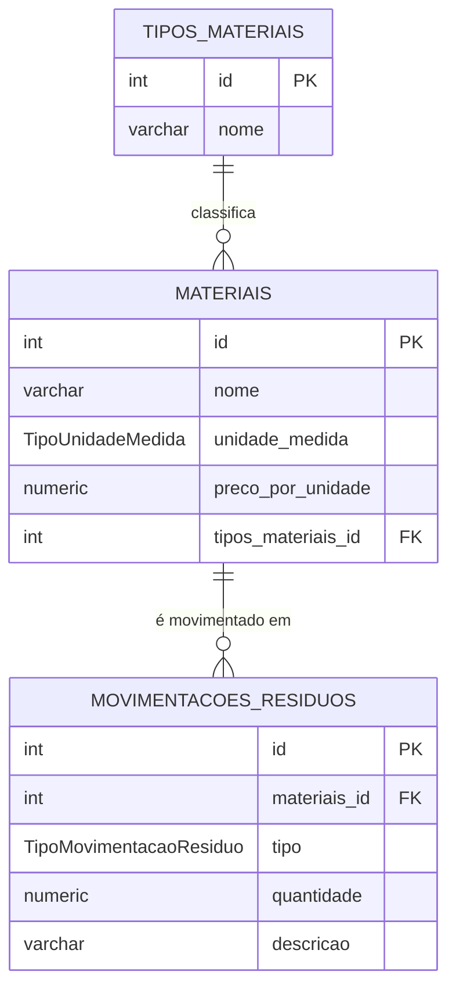

# Modelo de domínio

> No mínimo **3 entidades** e pelo menos **um relacionamento**.

## Entidades

Uma tabela por entidade. A coluna **Regra** é o que vira `NOT NULL`, `UNIQUE` ou validação no DTO.

### TipoMaterial

A categoria em que um material se enquadra (por exemplo, Metal ou Biológico).

| Atributo | Tipo Java | Coluna | Obrigatório | Regra |
|---|---|---|---|---|
| `id` | `Long` | `id` | sim | Gerado pelo banco |
| `nome` | `String` | `nome` | sim | Até 255 caracteres |

### Material

Um tipo de resíduo controlado pela produção, medido em uma unidade e com um preço agregado.

| Atributo | Tipo Java | Coluna | Obrigatório | Regra |
|---|---|---|---|---|
| `id` | `Long` | `id` | sim | Gerado pelo banco |
| `nome` | `String` | `nome` | sim | Até 255 caracteres. Único em conjunto com a unidade de medida (R3) |
| `unidadeMedida` | `TipoUnidadeMedida` | `unidade_medida` | sim | `UNIDADE`, `PECA`, `METRO` ou `QUILO` |
| `precoPorUnidade` | `Double` | `preco_por_unidade` | sim | Maior que zero (validação do DTO) |
| `tipoMaterial` | `TipoMaterial` | `tipos_materiais_id` | sim | Precisa existir |

### MovimentacaoResiduo

Uma entrada ou uma saída de um material, que alimenta o saldo daquele material.

| Atributo | Tipo Java | Coluna | Obrigatório | Regra |
|---|---|---|---|---|
| `id` | `Long` | `id` | sim | Gerado pelo banco |
| `movimentacaoResiduo` | `TipoMovimentacaoResiduo` | `tipo` | sim | `ENTRADA` ou `SAIDA` |
| `quantidade` | `Double` | `quantidade` | sim | Diferente de zero (DTO). Positiva na entrada e negativa na saída (R2). A saída não pode exceder o saldo (R1) |
| `descricao` | `String` | `descricao` | sim | Até 255 caracteres |
| `material` | `Material` | `materiais_id` | sim | Precisa existir |

## Relacionamentos

| De | Para | Tipo | No banco | No código |
|---|---|---|---|---|
| Material | TipoMaterial | muitos para um | `materiais.tipos_materiais_id` referencia `tipos_materiais(id)` | `@ManyToOne` em `Material` |
| MovimentacaoResiduo | Material | muitos para um | `movimentacoes_residuos.materiais_id` referencia `materiais(id)` | `@ManyToOne` em `MovimentacaoResiduo` |

## Diagrama ER

Como ler: `||--o{` é "um para muitos". Um tipo de material classifica zero ou vários materiais, e cada material tem exatamente um tipo. Um material tem zero ou várias movimentações, e cada movimentação é de exatamente um material.

## Migrations

Todas existem em `src/main/resources/db/migration`. A ordem importa: a tabela referenciada nasce antes da que referencia.

| Versão | Arquivo | O que cria |
|---|---|---|
| V1 | `V1_criar_tipos_materiais.sql` | Tabela `tipos_materiais` |
| V2 | `V2_criar_tipos_unidades_medidas.sql` | Enum `TipoUnidadeMedida` (`unidade`, `peca`, `metro`, `quilo`) |
| V3 | `V3_criar_materiais.sql` | Tabela `materiais`, com a chave estrangeira para `tipos_materiais` |
| V4 | `V4_criar_tipos_movimentacoes_residuos.sql` | Enum `TipoMovimentacaoResiduo` (`entrada`, `saida`) |
| V5 | `V5_criar_movimentacoes_residuos.sql` | Tabela `movimentacoes_residuos`, com a chave estrangeira para `materiais` |